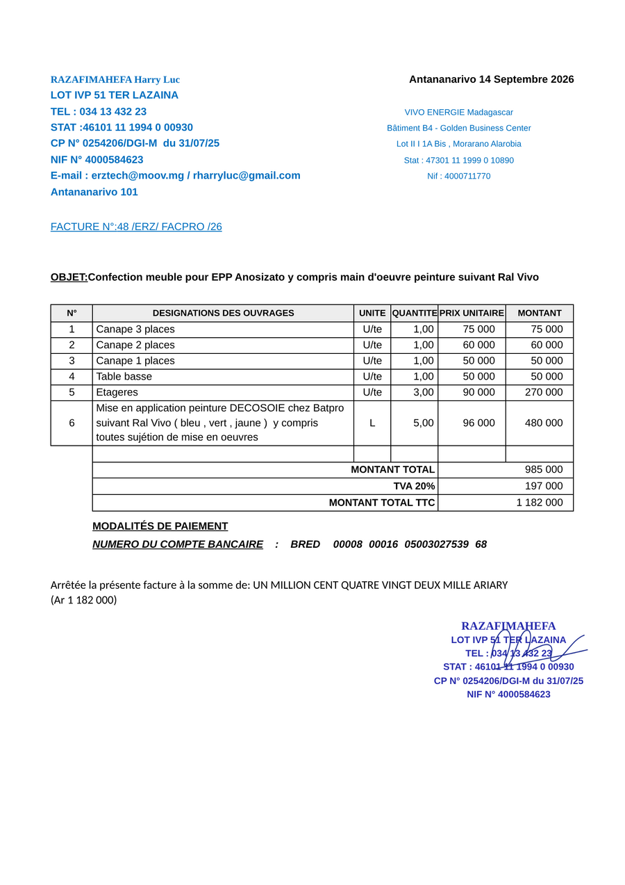

# DevisPro

Application Windows hors-ligne pour créer des **devis** et des **factures** A4 au nom de
RAZAFIMAHEFA Harry Luc. La page affichée **est** le formulaire : on écrit directement dessus,
et le PDF ou l'impression reproduisent le modèle `reference/facture-modele.jpg`.



## Utilisation

1. Décompressez `DevisPro-win-unpacked.zip`, puis lancez `DevisPro\DevisPro.exe`
   (aucune installation). Au premier lancement, Windows peut afficher « Windows a protégé
   votre ordinateur » : *Informations complémentaires* → *Exécuter quand même*
   (l'application n'est pas signée).
2. Choisissez **Devis** ou **Facture** dans la barre d'outils, puis remplissez la page :
   ville et date (cliquez sur la date pour l'agenda), destinataire, numéro, objet, lignes.
3. Lignes : **+ Ajouter une ligne** sous le tableau ; au survol d'une ligne, les boutons
   **+** (insérer dessous) et **×** (supprimer, annulable) apparaissent à droite, **↑ ↓** à gauche.
   Entrée dans la quantité ou le prix de la dernière ligne crée une nouvelle ligne.
   Une désignation peut tenir sur plusieurs lignes. L'unité se choisit dans la liste ou se tape librement.
4. **TVA** (20 % par défaut, modifiable ou désactivée), **Acomptes**, **Paiement** (espèces,
   virement) et **Signer** (dessin à la souris, au doigt ou au stylet, ou image importée).
5. **Acomptes** : autant d'acomptes que nécessaire (bouton « Échéancier 20 / 30 / 50 » ou
   « + Ajouter un acompte »). Pour chacun : le pourcentage **ou** le montant en Ar (l'un met
   l'autre à jour), un libellé libre (« Début des travaux », « Fin des travaux »…) et une case
   **Déduit**. Les acomptes cochés sont retirés du total (lignes « Acompte n°… » puis
   « Reste à payer »). Sur une **facture**, la phrase « Arrêtée la présente facture à la somme
   de: … » reprend le **reste à payer** ; pour une première facture, seul le premier acompte est
   déduit (cochez les suivants sur les factures suivantes). Sur un **devis**, la phrase garde le
   total TTC. L'échéancier et les moyens de paiement sont imprimés sous le titre
   **MODALITÉS DE PAIEMENT** (cliquez dessus pour les modifier).
6. **Enregistrer** (Ctrl+S), **Exporter PDF** (Ctrl+E, nom proposé
   `Facture-48-ERZ-FACPRO-26.pdf`), **Imprimer** (Ctrl+P), **Ouvrir** (Ctrl+O : ouvrir,
   dupliquer, supprimer), **Nouveau** (Ctrl+N : numéro suivant automatique, ex.
   `48 /ERZ/ FACPRO /26` → `49 /ERZ/ FACPRO /26`).

Un brouillon est gardé automatiquement toutes les 3 secondes et rouvert au lancement suivant.
À la fermeture, DevisPro prévient s'il reste des modifications non enregistrées.

## Où sont mes données ?

Dans `%APPDATA%\DevisPro\` (tapez ce chemin dans l'Explorateur) :

| Fichier            | Contenu                                         |
|--------------------|-------------------------------------------------|
| `documents\*.json` | un fichier par devis / facture enregistré        |
| `signature.png`    | la signature mémorisée (PNG transparent)         |
| `settings.json`    | réglages (dernier dossier PDF, couleur d'encre…) |
| `brouillon.json`   | le document en cours (sauvegarde automatique)    |

Pour une sauvegarde, copiez simplement ce dossier.

## Modifier l'en-tête (adresse, téléphone, NIF…)

Tout l'en-tête fixe et le cachet sont dans **`src/js/emetteur.js`** (simples textes entre
apostrophes). Après modification : `npm run build` puis `npm run zip` pour refaire l'exécutable.

## Pour le développeur

```
npm install          # electron + electron-builder (dépendances de développement uniquement)
npm start            # lance l'application
npm test             # tests unitaires (calculs, nombres en lettres)
npm run selftest     # document d'exemple → dist/selftest/apercu.pdf + apercu.png + rapport.txt
npm run build        # dist/win-unpacked/DevisPro.exe
npm run zip          # dist/DevisPro-win-unpacked.zip
npm run icon         # régénère build/icon.ico
```

Sous Linux : `xvfb-run -a npm run selftest -- --no-sandbox`.
L'autotest vérifie aussi l'interface (75 contrôles : totaux, TVA, acomptes, paiement, lignes,
frappe clavier réelle dans la première ligne, enregistrement, document de plusieurs pages). L'exécutable accepte la même option :
`DevisPro.exe --selftest --selftest-dir=C:\chemin\sortie`.

Le workflow GitHub Actions `.github/workflows/build-windows.yml` refait le build sous Windows,
lance `DevisPro.exe --selftest` et publie le zip dans l'onglet *Actions* du dépôt.

Si le build Windows s'arrête sur « Cannot create symbolic link » (winCodeSign), mettez
`"signAndEditExecutable": false` dans `package.json` (section `build.win`) ; en dernier recours,
utilisez `@electron/packager`. Si Node 18+ manque, téléchargez le zip portable officiel
Node LTS win-x64 dans `.tools/node` et ajoutez ce dossier au PATH de la console.

## Taille du build

| Élément                            | Taille  |
|------------------------------------|---------|
| `dist/win-unpacked/` (18 fichiers) | 320 Mo  |
| dont `DevisPro.exe` (Electron 44)  | 235 Mo  |
| `dist/DevisPro-win-unpacked.zip`   | 141 Mo  |

Seule la langue française de Chromium est gardée (`electronLanguages: ["fr"]`), le code est
dans `resources/app.asar`.

## Choix par défaut

Pris sans pouvoir demander, à revoir si besoin :

- **Dossier** : la racine du dépôt tient lieu de dossier `devis-pro/`. L'image modèle est
  enregistrée sous `reference/facture-modele.jpg` (le cahier des charges citait aussi
  `modele-facture.jpg`).
- **Node** : Node 22 était déjà présent dans l'environnement de build, donc pas de Node portable.
- **Polices** (celles de Windows, rien n'est téléchargé) : Arial pour l'en-tête et le tableau,
  Bookman Old Style pour le nom (sinon Georgia, puis Times New Roman), Calibri pour la phrase
  d'arrêté, comme sur le modèle.
- **Mise en page** : marges PDF de 12 mm, plus un retrait intérieur de 5 mm sur les côtés et
  12 mm en haut pour retrouver la position du modèle (positions vérifiées à ±1 mm).
- **Libellés** : « FACTURE N°: » collé au numéro et « TVA 20% » comme sur le modèle ;
  « MONTANT TOTAL » pour le total HT ; lignes « Acompte n°1 (20 %) » et « Reste à payer ».
- **Date** : « 1er » pour le premier jour du mois ; mois avec une majuscule (« 14 Septembre 2026 »).
- **Lignes** : une nouvelle ligne est vide (le montant s'affiche quand quantité et prix sont
  saisis) ; toutes les lignes sont numérotées ; une quantité ou un prix négatif est accepté
  (remise) ; une saisie invalide vaut 0.
- **Modalités de paiement imprimées** : titre en gras souligné « MODALITÉS DE PAIEMENT », puis
  une ligne par acompte (« Acompte n°1  20 %  Début des travaux  236 400 Ar  (déduit) »), puis
  « PAIEMENT : EN ESPECES » et « NUMERO DU COMPTE BANCAIRE : BRED … » (virement coché par
  défaut). Le titre disparaît s'il n'y a rien dessous. Mobile Money a été retiré.
- **Acomptes** : orthographe « acompte » (avec un seul c). Les pourcentages s'appliquent au
  total TTC. Un acompte déduit ne fait jamais passer le reste à payer sous zéro. L'échéancier
  type 20 / 30 / 50 (Début des travaux / Mi-parcours des travaux / Fin des travaux) se modifie
  dans `src/js/emetteur.js`. Passer un devis en facture déduit d'office le premier acompte s'il
  n'y en a aucun de déduit. Les documents de l'ancienne version avec une « avance » sont
  convertis en un acompte déduit.
- **Signature** : deux cases, « Afficher la signature » et « Afficher le cachet » ; encre bleue
  (noire au choix) ; à l'import, le fond blanc est rendu transparent (option) ; la signature
  se pose sur la partie droite du cachet ; encre du cachet `#2A2EAE`, relevée sur le modèle.
- **Numérotation** : « Nouveau » part du dernier document créé du même type (sinon du numéro
  affiché, sinon `1 /ERZ/ FACPRO /AA` ou `1 /ERZ/ DEVIS /AA`). « Dupliquer » donne le numéro
  suivant et la date du jour. « Nouveau » garde le type, la ville, la TVA, l'échéancier
  d'acomptes (facture : seul le premier déduit), le paiement et les options de signature du
  document précédent.
- **Brouillon** : écrit toutes les 3 s ; il est rouvert au lancement même après « Quitter sans
  enregistrer » (rien n'est perdu ; il reste marqué « Non enregistré »).
- **Hors-ligne strict** : correcteur orthographique désactivé (il téléchargerait des
  dictionnaires) et toute requête réseau de la page est bloquée.
- **Montant au-delà de 999 999 999 999 Ar** : la phrase d'arrêté affiche « (MONTANT HORS LIMITE) ».
- **Vérification du build** : l'environnement de build est sous Linux, où un `.exe` Windows ne
  peut pas être lancé. Le code empaqueté (`app.asar`) a passé l'autotest complet avec
  Electron, et le workflow GitHub Actions lance réellement `DevisPro.exe` sous Windows.
